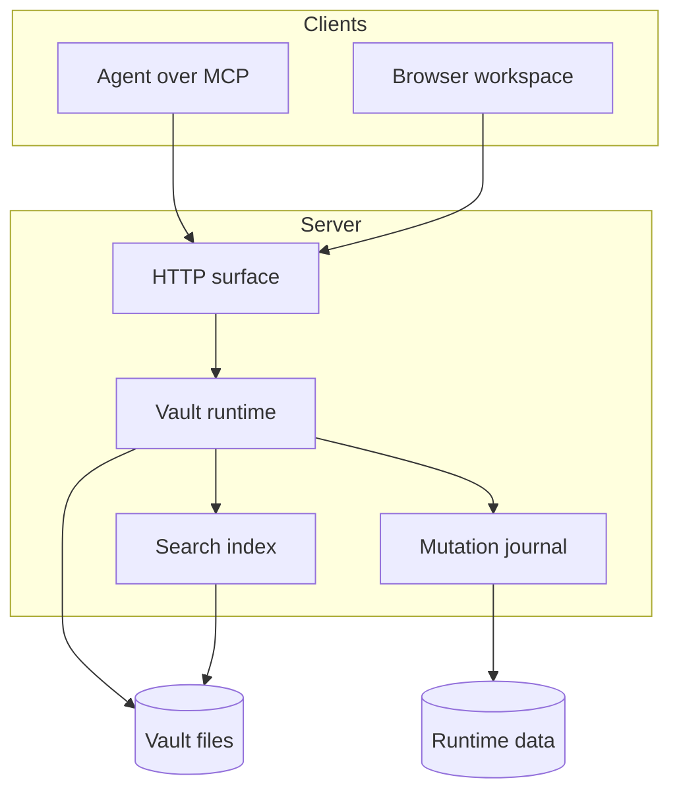

# Workspace Architecture

## Layers

| Layer | Responsibility | Does not own |
| --- | --- | --- |
| HTTP surface | Auth, routing, sessions | File formats |
| Vault runtime | Path resolution, reads, writes | Transport details |
| Mutation journal | Plans, recovery, replay | Rendering |
| Search index | Chunking, ranking, links | Write ordering |

## Content boundary

The demo vault is entirely synthetic. It never reads a production vault, and the public screenshots are captured against a local instance whose data directory lives outside the repository.

## Write path

1. Resolve the vault and canonicalise the path.
2. Read the current revision token.
3. Apply the plan against that exact revision.
4. Write atomically and record the previous version.
5. Return the new revision and the affected paths.

> [!important] Optimistic concurrency
> A write without `ifMatch` is only safe for new documents. Existing documents must round-trip their revision token.

## Related

- [[_Workspace/30-Knowledge/Engineering/Operator Runbook]]
- [[Canvas/System Map.canvas]]
- [[_Workspace/40-Projects/atlas-migration/Cutover Plan]]
