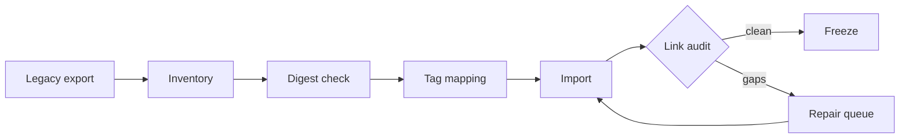

# Atlas Cutover Plan

## Sequence

1. Snapshot the legacy export and record the checksum.
2. Run the inventory against the snapshot, not the live folder.
3. Import into a staging vault.
4. Audit unresolved links and orphan notes.
5. Promote only after the audit is clean.

## Exit criteria

- Zero unresolved links introduced by the import
- Every attachment has a resolvable target
- The staging vault passes the same smoke checks as production
- The legacy export is read-only for seven days

Related: [[_Workspace/40-Projects/atlas-migration/README]] · [[_Workspace/30-Knowledge/Engineering/Operator Runbook]]
