# Obsidian MCP 授权管理（Admin）· UI 原型

这是 Admin 后台（`/admin/auth`、`/admin/auth/access-policy`、`/admin/auth/vault-git`）的高保真重设计原型。视觉与交互沿用已认可的 Message Server 原型（Notification Server 仓库的 UI 原型，不在本仓库）的设计体系：4px 栅格、字号只用 13 / 14 / 16 / 20、字重只用 400 / 600、52px 页头、`data-theme` 深浅色两套 token（accent / amber / danger），以及类似 Linear 的密度。

> **仅作设计参考，未接入服务端：** 位于 `docs/admin-ui-proto/`，不由服务端提供，也不进 Docker 镜像（镜像只构建 `app/`）。 页面里的数据全部是写死的 dummy mock，没有真实密钥。当前 Admin 是无脚本 SSR（CSP `default-src 'none'`），原型里有些即时交互，比如实时生效预览和主体搜索，正式实现时要么放宽 CSP，要么改成「预览」提交按钮的无脚本形态，见「待决问题」。
>
> **硬约束：不能有功能缺失，只能做功能增强。** 现有 Admin 的每个路由、表单、字段、筛选、排序、动作、状态和提示都已在原型中保留，逐项对照见「功能对照表」。

## 怎么打开

`index.html` 是单文件，没有外部依赖，用 `file://` 直接打开即可交互。窗口宽度 ≤ 720px 时切换到移动端布局：底部导航、表格改为卡片、抽屉从底部弹出。

## 路由与 URL

| 形式 | 作用 |
| --- | --- |
| `#/login` | 登录页 |
| `#/overview` | 概览 |
| `#/accounts[/<userId>]` | OAuth 账户；带 id 时打开详情抽屉（编辑权限、重置密码、停用、删除） |
| `#/keys[/<keyId>]` | API Key；`configured-env` 为环境变量 Key，只读 |
| `#/clients[/<clientId>]` | OAuth 客户端；详情抽屉内有转移授权账户 |
| `#/tokens` | OAuth Token（按授权合并为一行） |
| `#/publish` | 发布文档 |
| `#/audit?outcome=&action=&credential=&origin=&source=&q=&focus=` | 审计；筛选可以深链 |
| `#/authz` | 定时授权列表 + 当前状态预览 |
| `#/authz/new`、`#/authz/<policyId>` | 策略编辑器（整页，取代原来嵌在表格里的面板） |
| `#/vaults[/<vaultId>]` | Vault 与 Git；带 id 时打开详情与 Git 设置抽屉 |

打开或关闭抽屉会 pushState，所以浏览器后退等于关闭抽屉；切换筛选 Tab 不改历史。

**仅开发 / 截图用的参数（必须带 `?dev=1` 才生效）**：

| 参数 | 作用 |
| --- | --- |
| `theme=light\|dark` | 指定主题 |
| `future=0` | 隐藏全部「规划中」元素，只看现有功能的增强版 |
| `lock=1` | 登录页显示「连续失败已锁定」 |
| `broken=authz\|git` | 模拟策略存储或 Git 配置存储损坏（修复表单） |
| `conflict=1` | 下一次保存策略时模拟修订冲突（CAS stale） |
| `flash=1` | API Key 页显示「新 Key 仅显示一次」 |
| `empty=<page>` | 把某页渲染成空状态 |
| `authz=off` | AuthZ 总开关关闭 |
| `kbd=1` | 打开快捷键面板 |
| `menu=<kind>:<id>` + `mi=<action>` | 打开某行的 ⋯ 菜单，并触发其中一项（用于截确认框） |
| `act=<data-act>` | 启动后点击某个按钮 |
| `subj=<q>` | 预填策略编辑器的主体搜索 |
| `ua=<auditId>` | 展开某条审计记录 |

## 已定交互规则

- **术语**（#456）：UI 全部使用中文，状态枚举都本地化，例如 有效 / 已轮换 / 已撤销 / 已过期、成功 / 失败、暂停 / 撤销、启用 / 停用。开发者用的 key（`obsidian.read`、`autoCommit`、`suspend` 等）只出现在等宽灰色副标、tooltip 或「技术细节」折叠里。
- **名称优先**（#459、#455 裁定甲）：主行显示人类可读名称，次行显示类型和缩略 id，完整 id 点击即可复制。没有备注名时显示斜体「未命名」加缩略 id；凭据已删除时显示「已删除 / 未知」加 id，两种情况分开处理。
- **行操作**（#460）：表格里只有一个 ⋯ 菜单；点击行打开右侧详情抽屉，编辑在抽屉中完成，不再常驻可编辑的复选框。危险操作统一放在抽屉底部的「危险操作」区。
- **危险层级**（#457）：主按钮用蓝色实心；普通操作用描边按钮；危险入口用红色描边，最终确认用红色实心。危险操作一律走确认框。**删除类操作和清空日志需要输入名称确认**（type-to-confirm）；停用、撤销只需二次确认，并写明后果。操作结果用 toast 反馈。
- **改权限会撤销授权**：保存账户权限、重置密码、停用账户时，确认框和抽屉里的琥珀色横幅都会写明「将撤销 N 个客户端的授权」。
- **琥珀色**只表示「需要关注」（转移待完成、失效发布、24 小时内有失败）；**红色**只表示失败或危险。
- **审计**（#458、#403）：固定 6 列，没有横向溢出。失败行整行淡红底色；User-Agent、动作键、失败原因收进可展开的行内详情；来源 IP 只显示一次，并标注「本机直连 / 内网 / 公网」。
- **策略编辑器**（#455、#406、#434）：整页编辑，左边是表单，右边是固定的「生效预览」（摘要 + 7 日时间线 + 现在标记 + 当前判定 + 对每个主体的影响）。起止时间用 `datetime-local`，按策略时区解释，旁边显示存储的 UTC 值。每周窗口用星期 chip 加时间行，并提供「工作日 9–18 / 每天 / 清空」快捷项；跨午夜会给出提示。日期区间是可增删的起止日期对。选择「撤销」模式时能力会锁定为「全部」，并有静态提示。表单底部有「保存 / 取消」，删除放在右侧。
- **本地存储** `storageKey(name)` = `omcp-admin.<name>`（目前只有 `theme`）。
- 时间统一按 Asia/Shanghai 显示：列表用相对时间，hover 显示完整时间。

## 快捷键

`?` 快捷键面板 · `/` 聚焦当前页搜索 · `g o/a/k/c/t/p/u/z/v` 跳到 概览 / 账户 / Key / 客户端 / Token / 发布 / 审计 / 定时授权 / Vault · `n` 新建（当前页） · `j/k` 在表格中上下移动 · `Enter` 打开 · `Esc` 关闭菜单 / 抽屉 / 编辑器 · `t` 切换主题 · `⌘/Ctrl+Enter` 保存策略 · 确认框中按 `Enter` 确认、`Esc` 取消。

## 功能对照表（现有功能 → 原型位置 → 增强点）

来源：`app/src/admin/**` @ main `3bc97da`。✅ 表示已映射，共 **92 / 92** 项现有功能，没有无法映射的项（另有标「—」的行是新增能力；CSRF / 会话属于实现层，原型中不模拟）。

### 全局 / 登录（auth-center.js）

| 现有功能 | 原型位置 | 增强点 |
| --- | --- | --- |
| `GET /login` 登录页 | `#/login` | 卡片居中、整宽主按钮、版本与 Web 入口放在底部 |
| `POST /login`：管理密码 | 登录表单 | 增加显示 / 隐藏密码 |
| 登录失败锁定（`failures` 按 IP 计数） | 登录页错误行（`?dev=1&lock=1`） | 明确写出「已临时锁定，15 分钟后再试」 |
| 「不接受 OAuth 账户密码、API Key 或 Token」提示 | 登录页说明 | 提高对比度，关键词加粗 |
| `POST /logout` | 侧栏底部「退出」+ 确认 | — |
| 页头「进入 Obsidian Web」 | 侧栏底部常驻链接 | 所有页面位置一致（#399、#457） |
| 部署版本 `1.0.0` | 登录页底部、概览「运行状态」 | 增加 commit 信息 |
| 9 个 Tab 导航（含 定时授权 / Vault 与 Git 两个独立页面） | 左侧分组导航（移动端为底部导航 + 「更多」） | 一个心智模型，不再折行（#399、#463） |
| flash 消息（`flashMessage`） | toast | 统一反馈位置 |
| 新 Key 明文只显示一次（`flashKey`） | API Key 页琥珀色横幅 + 复制 | 写明离开后无法再看 |
| CSRF / 会话 | 原型不模拟 | 实现保持不变 |

### 概览

| 现有功能 | 原型位置 | 增强点 |
| --- | --- | --- |
| 6 张计数卡（账户 / Key / 客户端 / 活动 Token / Publish / 审计） | 8 张卡，全部可点击跳转 | 每张卡下有一行可行动的说明（#462）；新增定时授权、Vault 两张卡 |
| 「授权状态」说明卡 | 「说明」块 + 新的「运行状态」 | 真实状态：AuthZ、各 Vault 的 Git、版本 |
| Publish 已失效记录（orphaned / invalid）计数提示 | 「需要关注」列表 + 发布卡 | 可直接跳转处理 |
| — | 「需要关注」「最近失败」 | 新增：转移待完成、登录暴力尝试、失效发布、未初始化 Git |

### OAuth 账户

| 现有功能 | 原型位置 | 增强点 |
| --- | --- | --- |
| 列表：账户（显示名 / 用户名） | 名称列（主行显示名，次行用户名 + 短 id） | 缺显示名时有明确占位，行高统一 |
| 列：已授权客户端 | 「已授权客户端」列，可点击跳转 | 可链接 |
| 列：创建时间 | 「创建」列 | — |
| 列：最后登录 / 来源 IP | 「最后登录」列 | 相对时间 + IP |
| 列：权限与 Vault | 只读 tag | 默认只读（#460） |
| `POST /oauth/user/create`：用户名、显示名、初始密码、权限上限、允许的 Vault | 「新建账户」抽屉 | 字段带说明，复选项附中文说明 |
| `POST /oauth/user/scopes`：权限上限 + Vault | 详情抽屉「权限上限与 Vault」 | 保存前写明「会撤销已有授权」并二次确认 |
| `POST /oauth/user/password` | 抽屉「重置密码」+ ⋯ 菜单 | 确认框写明后果 |
| `POST /oauth/user/toggle` 停用 / 启用 | ⋯ 菜单、抽屉危险区 | 停用需确认，启用直接执行 |
| `POST /oauth/user/delete` | ⋯ 菜单、抽屉危险区 | 输入用户名确认 |
| 页头警告「改密、调整权限或 Vault 会撤销已有授权」 | 抽屉内琥珀色横幅 + 概览说明 | 放在保存按钮旁边 |

### API Key

| 现有功能 | 原型位置 | 增强点 |
| --- | --- | --- |
| 列：备注 / 前缀 | 名称列（备注 + 前缀 + 短 id） | 未命名 Key 有占位 |
| 列：Scope / Vault | 「权限 · Vault」tag | 消除与操作列的重复 |
| 列：创建时间、最后调用、来源 | 对应三列 | 最后调用附带 Agent |
| `POST /api-key/create`：备注、Scope、Vault | 「新建 Key」抽屉 | 分组清楚，附说明 |
| `POST /api-key/scopes` | 详情抽屉 | — |
| `POST /api-key/delete` | ⋯ 菜单、抽屉危险区 | 输入名称确认，提示会产生孤立主体 |
| 环境配置 `configured-env` 行（只读、在 .env 中轮换） | 锁形图标 + 详情抽屉说明 | 修正列错位（#459），解释清楚 |

### OAuth 客户端

| 现有功能 | 原型位置 | 增强点 |
| --- | --- | --- |
| 列：客户端名称 + client_id | 名称 + 短 id 可复制 | 不再显示 4 行 UUID |
| 列：已授权账户（active-grant 推导） | 「已授权账户」列，可链接 | — |
| 列：连接域名 + 来源（注册 / 授权 / 调用） | 列 + tooltip；抽屉内完整显示 | 来源 pill 有解释 |
| 列：创建时间 | 抽屉「注册」 | — |
| 列：最后调用 / 来源 | 「最后调用」列 | — |
| 列：回调地址（多个） | 首个 + `+N`；抽屉中完整列出并可复制 | 不再从中间断行 |
| `POST /oauth/client/revoke` | ⋯ 菜单、抽屉危险区 | 确认框列出受影响的账户 |
| `POST /oauth/client/delete` | ⋯ 菜单、抽屉危险区 | 输入名称确认 |
| 转移 begin（`sourceUserId` → `targetUserId`，#364） | 抽屉「转移授权账户」：从 / 转到 + 确认 | 已停用账户显示但不可选 |
| 转移 cancel（`transferId`） | 抽屉横幅「取消转移」+ ⋯ 菜单 | 待完成状态在列表里有琥珀色 tag |

### OAuth Token

| 现有功能 | 原型位置 | 增强点 |
| --- | --- | --- |
| 列：类型 / ID | 「Token（短 ID）」：访问 + 刷新合并在一行 | 按 grant 分组（#459） |
| 列：客户端 / 账户 | 首列 | 名称优先 |
| 列：绑定域名（resource） | 页面说明一次 | 去掉每行重复 |
| 列：Scope / Vault、创建时间、最后调用 / 来源、状态 | 对应列 | 状态本地化 |
| 排序 `order=desc\|asc` | 工具栏排序下拉 | 改变即生效，无需按钮 |
| `POST /oauth/token/revoke` | ⋯ 菜单「撤销此授权」+ 确认 | 移动端不再出现满宽红条（#463） |
| `POST /oauth/token/cleanup`：7 / 30 / 90 天 / 全部 | 页头「清理历史记录…」确认框内选择 | 与排序分离；结果 toast 显示 access / refresh 数量 |
| — | 状态筛选 全部 / 有效 / 已轮换 / 已撤销（含计数） | 新增 |

### 发布文档（publish-view.js）

| 现有功能 | 原型位置 | 增强点 |
| --- | --- | --- |
| 列表：Vault、路径、公开 ID、公开链接、发布者、时间、状态 | 文档列（标题 + Vault + 路径）、链接列（短 ID + 复制）、发布者、时间、状态 | 不再断行；发布者使用名称 |
| `POST /publish/revoke` | ⋯ 菜单 + 确认 | — |
| 已失效记录（orphaned / invalid）保留可撤销 | 琥珀色状态 + 横幅 | 用人话写明原因 |
| 计数行「仅 active 进入 published: 候选」 | 页面说明 | 去掉术语 |

### 审计

| 现有功能 | 原型位置 | 增强点 |
| --- | --- | --- |
| 列：时间、结果、动作、凭据、域名、Agent（来源）、来源、MCP 调用、User-Agent | 6 列 + 行内展开（动作键、域名、凭据类型、UA、失败原因） | 不再横向溢出（#458、#403） |
| 筛选：结果 | 分段控件 | — |
| 筛选：动作（oauth / web / mcp） | 下拉（MCP / OAuth / Web / 管理 / 管理员登录） | 本地化 |
| 筛选：凭据类型 | 下拉（本地化） | — |
| 筛选：域名、来源 IP | 两个输入框 | — |
| 筛选：调用 / User-Agent 关键字 | 搜索框（`/`） | 也会搜动作中文名和凭据名 |
| 每页 25 / 50 / 100 | 分页栏下拉 | — |
| 筛选 / 重置 | 即时筛选 + 「重置」 | — |
| 分页 | 底部分页 + 总数 + 失败数 | 新增失败计数 |
| `POST /audit/clear` | ⋯ 菜单 → 输入「清空日志」确认 | 从醒目位置移走（#458） |
| 失败行标红 | 整行淡红底色 | — |
| 凭据名称解析（`resolveAuditCredential`） | 凭据列「客户端 · 账户」/「API Key · 名称」 | 「none」显示为「匿名」 |

### 定时授权（access-policy*.js）

| 现有功能 | 原型位置 | 增强点 |
| --- | --- | --- |
| 策略表：标签、模式、状态、主体、能力、窗口、操作 | 列表 6 列 + ⋯ 菜单 | 名称优先，摘要 + 日期 tag，显示「现在允许 / 受限」（#405、#434） |
| `POST /create` | `#/authz/new` 编辑器 | 见规则 |
| `POST /update`（含 `expectedRevision`） | `#/authz/<id>` 编辑器 | — |
| 修订冲突（stale）提示 | 编辑器顶部红色横幅（`?dev=1&conflict=1`） | 提供「载入最新 / 查看差异」 |
| `POST /toggle` | ⋯ 菜单；编辑器内开关 | 停用需确认 |
| `POST /delete` | ⋯ 菜单、编辑器底部 | 输入名称确认 |
| 字段：标签、模式、状态、时区、startsAt、expiresAt、每周窗口、日期区间、主体、能力 | 编辑器的 4 个分组 | 全部改为结构化控件 |
| 能力搜索 `capq` | 能力选择器内的搜索 | 新建和编辑都有；不重新加载页面 |
| revoke 模式锁定为 `all` | 选「撤销」后自动锁定并提示 | 即时联动 |
| 窗口详情 `?window=` | 编辑器右侧「生效预览」+ 列表窗口列 | 可视化时间线 |
| `POST /preview` 当前状态预览（按主体） | 列表页底部「当前状态预览」+ 编辑器「对主体的影响」 | 默认「请选择主体」，显示名称 |
| 孤立 subject 提示 | 列表页琥珀色横幅 + 行内「孤立」tag + 编辑器提示 | — |
| `POST /repair` 策略存储损坏修复（粘贴 JSON） | 红色横幅 + 文本框 + 输入「覆盖」确认（`?dev=1&broken=authz`） | 写明会备份 |
| 页头说明（只能收紧、suspend / revoke、Admin 不受约束）+ revision | 一句话说明 + 「技术细节」折叠 | — |

### Vault 与 Git（vault-git-*.js）

| 现有功能 | 原型位置 | 增强点 |
| --- | --- | --- |
| 摘要表（11 列） | 5 列表格 + 抽屉 | 不再挤压（#401） |
| 详情：id、name、root、canonicalRoot、角色（主库） | 抽屉标题 + 「状态」kv | 合并冗余（#461） |
| Git 运行时状态、repository、HEAD、领先 / 落后 | 「Git 仓库」「最近推送」 | 「未知状态」改为「未初始化 Git 仓库」并说明如何处理 |
| 待提交路径 + 作者 | 「待提交」行 | 作者按 `{agent, model}` 渲染（#400） |
| configError、配置来源、updatedAt | 「配置来源」，错误时显示红色状态 | — |
| timers（sweep） | 「定时任务」 | — |
| 能力（13 项）+ 不可用原因 + 技术细节 | 能力 chip（未启用的用虚线，不用红色）+ 中文原因 + 折叠 | #402 |
| 配置表单 9 字段（enabled / autoCommit / autoPush / autoCommitSweep / debounce / maxDelay / sweepInterval / remote / branch） | 抽屉「Git 同步设置」：4 个开关 + 3 个数字 + 2 个文本 | 中文主标签 + key 副标（#404） |
| `POST /save`（`expectedRevision`） | 「保存设置」 | — |
| `POST /verify` | 「验证仓库与配置」、⋯ 菜单 | 结果 toast |
| `POST /refresh` 刷新 Vault 清单 | 页头按钮 | — |
| 不可编辑（`editable=false`）禁用 | 控件 disabled | — |
| Git 配置存储损坏卡片 + 修复 | 红色横幅 + 输入「重置」确认（`?dev=1&broken=git`） | — |

## 规划功能（紫色虚线「规划中」徽标；`?dev=1&future=0` 隐藏）

| 功能 | 来源 | 原型位置 |
| --- | --- | --- |
| AuthZ 总开关（Stage 5 启用） | README「#281 Stage 0 默认关闭」 | 定时授权页横幅右侧、概览「运行状态」 |
| 撤销时同时断开在线 MCP 会话 | #441 | 撤销 Token / 撤销客户端的确认框 |
| 管理员直接为目标账户签发等价授权（免重新同意） | #364 开放问题 1 / 5 | 客户端抽屉「转移授权账户」 |
| 审计归因：转发链与受信代理、Agent 来源 | #285 | 审计行内展开 |
| API Key 绑定 Agent 名（替代 UA 推测） | #285 | Key 详情抽屉 |
| 扫描新 Vault / 热刷新（无需重启） | #437 | Vault 页头按钮、抽屉「运行时」 |
| GitHub-backed Vault | Architecture README（规划） | Vault 页底部 |
| 部署信息（tag / 上次部署时间） | Deployment 笔记 | 概览「运行状态」 |
| 发布访问统计 | 设想 | 发布列表时间列 |
| 审计导出 CSV | 设想 | 审计页头 |
| Key 轮换、Key 到期时间 | 设想 | Key ⋯ 菜单、新建 Key 抽屉 |

## 覆盖的 issue 清单

| issue | 原型中的解决方式 |
| --- | --- |
| #455 主体缺名称、控件粗糙（含评论裁定甲） | `subjectView()` 统一 view-model（名称 + 类型 + 缩略 id；区分未命名与已删除），用于选择器、列表、预览、孤立提示；结构化时间控件；UTC 回显；占位符斜体浅色，并改用远离当前的示例；取消按钮 |
| #456 术语统一 | 全中文枚举；key 只出现在副标 / tooltip |
| #457 视觉规范与危险按钮 | 按钮四级 + 危险区 + 确认框 / 输入确认；登录页重做 |
| #458 审计表 | 6 列 + 展开行 + 筛选栏 + 失败底色 + 清空日志移入菜单 |
| #459 表格可读性 / 原始 ID | 名称优先 + 短 id 复制；env Key 行修正 |
| #460 行操作 / 常驻编辑 | ⋯ 菜单 + 抽屉编辑 |
| #461 Vault 与 Git IA | 表格 + 抽屉；字段中文；能力 chip |
| #462 概览 | 可点击卡片 + 需要关注 + 运行状态 + 最近失败 |
| #463 窄屏 | 底部导航、卡片、底部抽屉，无满宽红按钮 |
| #364 客户端账户转移 | 转移表单 + 待完成状态 + 取消 |
| #285 审计归因 | 来源分类、Agent 来源标注；规划中：转发链 |
| #399 / #400 / #401 / #402 / #403 / #404 / #405 / #406 / #434 | 导航统一 / 作者渲染 / 摘要表 / 能力 chip / 审计列宽 / 配置表单 / 策略表密度 / 整页编辑器 / 窗口语义摘要与时间线 |

## 待决问题

1. **无脚本约束**：生效预览、主体与能力搜索、模式联动在原型中都是即时的。正式实现是放宽 CSP 引入少量 JS，还是走「预览」提交按钮（#455 开发文档的形态）？
2. **策略语义**：原型把每周窗口理解为「允许访问的时间」，窗口外执行暂停或撤销。需要和 #269 契约再核对一遍措辞。
3. **转移流程**（#364）：目前按「撤销 A + 等 B 重新同意」实现；是否需要「管理员代签」？
4. **审计**：是否要服务端分页之外的「导出」？清空日志是否改为「按时间清理」？
5. **Token 按 grant 合并**：需要服务端提供 grant id（或按 client + user + 时间推导）。
6. 策略表 chip 里显示全名还是只显示名称（#455 开放问题 1）：原型显示名称 + 类型，id 放在 tooltip。

## 目录

| 路径 | 说明 |
| --- | --- |
| `index.html` | 原型本体（= `src/` 六个片段按顺序拼接） |
| `src/` | `1-head.html`（head + 全部 CSS）、`2-css.html`、`3-body.html`（图标 + 外壳）、`4-data.js`（mock）、`5-render.js`（各页渲染）、`6-app.js`（路由、抽屉、菜单、确认框、快捷键、dev 参数） |
| `screenshots/` | 35 张截图（1440 宽桌面 / 390 宽移动端） |
| `tools/cdp-shot.mjs` | 单张截图（headless Chrome + CDP，会输出页面异常） |
| `tools/shots.sh` | 一次重拍全部截图 |

重新生成：`cat src/1-head.html src/2-css.html src/3-body.html src/4-data.js src/5-render.js src/6-app.js > index.html`

## 截图

| | |
| --- | --- |
| 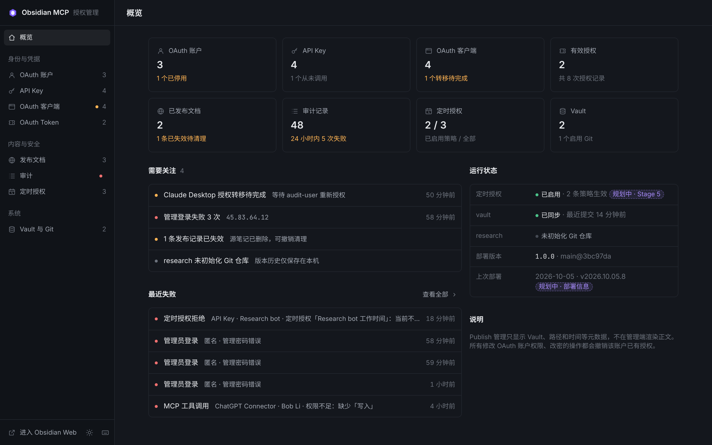 | 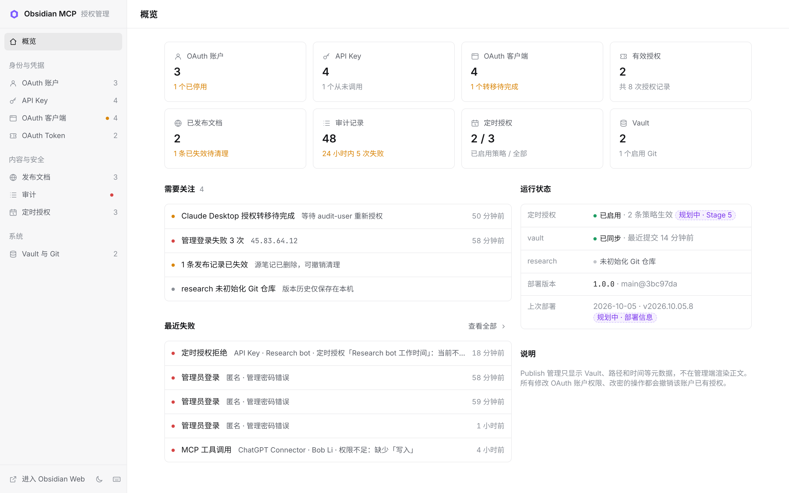 |
| 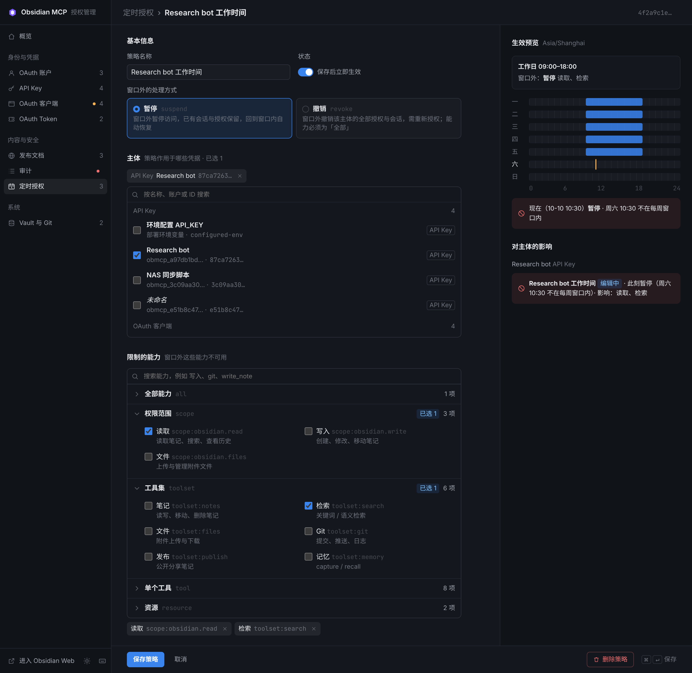 | 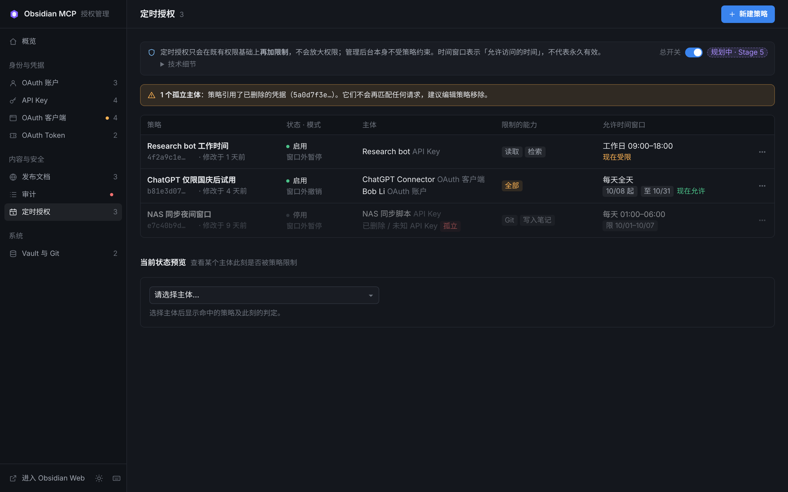 |
| 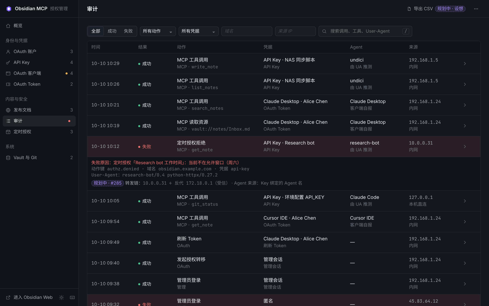 | 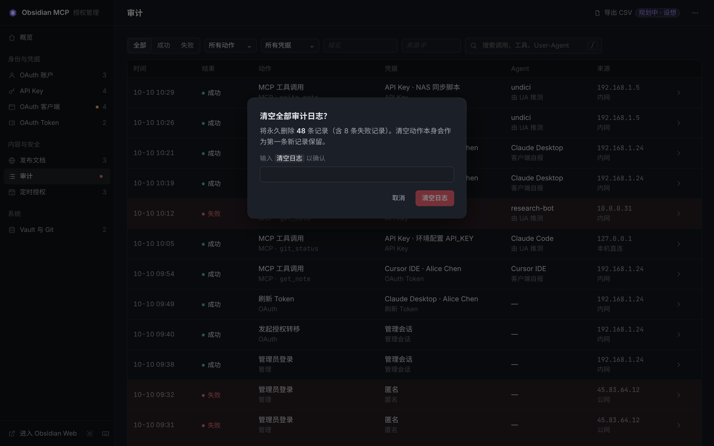 |
| 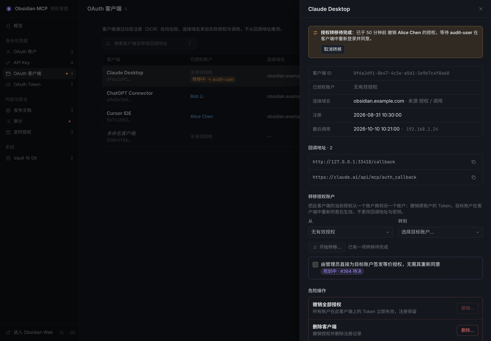 | 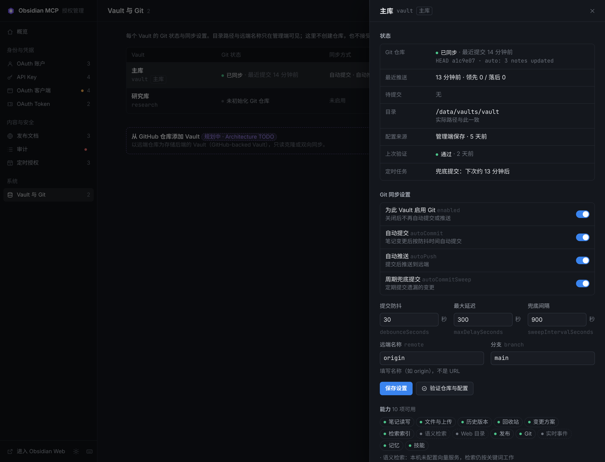 |
| 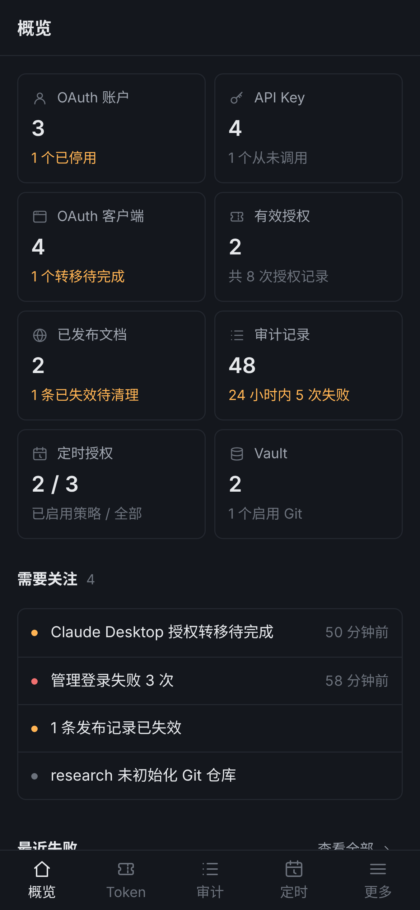 | 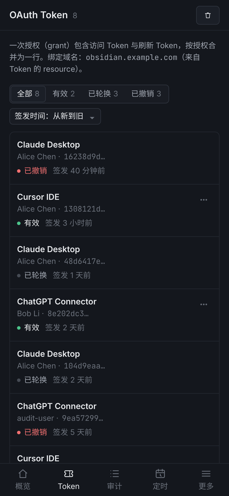 |
|  | 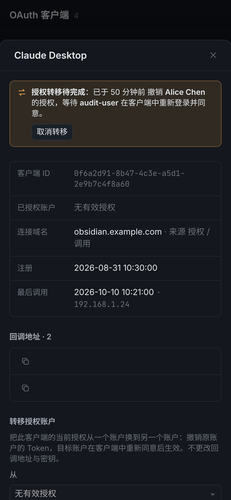 |

## 参照前推记录（先实现、后补参照）

参照是我们自己的设计参照，不是桌面 asar 那个真源。当一次**有意的**设计变更先落到实现、参照落后时，
正确做法是把参照往前推；给实现发**区域级豁免**会让"这一块以后怎么变都不报"，那是假守卫的温床。

| 日期 | 分节 | 起因 | 说明 |
| --- | --- | --- | --- |
| 2026-10-22 | OAuth 客户端抽屉「默认 Vault」 | #643（issue #642） | 客户端的"默认作用域"：不指定 `vaultId` 时用哪个库；偏好不等于授权。参照补齐 `form.dsec > h3 + .sel + 提交按钮`，与实现逐项对齐。协调席 2026-10-22 裁决：改参照、不动豁免预算。 |

改完参照必须带**负控**：另造一处结构性改动（例如再塞一个 `div.dsec`），门禁必须照样红 ——
证明参照是被"前推"而不是被"调成恒绿"。
